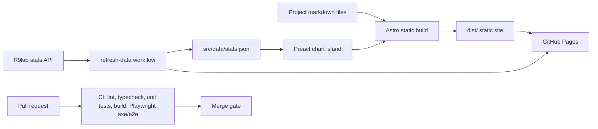

# Architecture

This is a small static portfolio site. I favour reproducible builds, few moving parts at runtime, and enough automation to keep the published figures current.

## Runtime shape

- Astro renders the pages statically, with TypeScript in strict mode.
- Project rows (the parts list) are markdown files under `src/content/projects/`, validated against the schema in `src/content.config.ts`.
- The only client-side island is `DisassemblyChart.tsx`. It hydrates when it scrolls into view, so users can switch between R9lab measures. It also renders a visually hidden table, so the same data is available without reading the SVG.

## The CV

[/cv/](https://simonvanlierde.github.io/cv/) renders from `src/data/cv-public.yaml`. The landing page reads only the contact details from it and links to the CV. I export that file and the CV PDF from a separate private repo and commit them here, so a clean checkout builds without access to that repo.

`src/data/cv.ts` validates the export against a Zod schema at build time, so a broken export fails the build instead of rendering an empty page. `src/data/schemaOrg.ts` builds the JSON-LD (structured data for search engines) from the same object. Optional sections (publications, skills, projects, talks and training, interests) render only when the export carries them. An unaccepted publication stays hidden until it has a preprint DOI to link to.

## Data refresh

`src/data/stats.json` is committed because GitHub Pages serves a static build. The weekly `refresh-data.yml` workflow runs `scripts/fetch-stats.mjs`. The script checks that the public R9lab `/stats` response still has the fields the chart reads. The workflow commits the new snapshot if it changed, then deploys.

If the API is unavailable, blocked, or returns an unexpected shape, the script exits successfully without touching the snapshot. That keeps the last known-good build online, instead of quietly rendering zeros. It prints a `::warning::` line, which shows as an annotation on the workflow run.

## Checks

Pull requests and pushes to `main` run `pnpm check`, a production Astro build, and Playwright tests. Accessibility is checked twice (what that covers is in [accessibility.md](accessibility.md)):

- **Static**: Biome's `a11y` rules (`pnpm lint`) flag missing `alt` text, misused ARIA, and click handlers without keyboard equivalents.
- **Runtime**: Playwright runs axe-core over the built page (`tests/a11y.spec.ts`) with the WCAG 2.2 A and AA and best-practice rules, in both colour schemes and after interaction. `tests/e2e.spec.ts` checks the skip link, theme-toggle persistence, and the chart's `aria-pressed` toggles.

## Deployment

Pushing to `main` triggers `deploy.yml`, which builds the site and publishes it to GitHub Pages. For this to work, the Pages source must be set to **GitHub Actions** (Settings → Pages). The refresh workflow starts the deploy workflow with `gh workflow run`, and the deploy workflow holds the `pages` concurrency group, so deployments queue instead of racing.

`check-drift.yml` runs 30 minutes after `refresh-data.yml` starts. It keeps one issue open while public repos with new commits are missing from this site, or while the site or the profile README links a repo that was renamed, archived or deleted, or while `stats.json` is more than 21 days old. To skip a repo, list it in `.github/drift-ignore`.

Renovate opens one PR a month for minor and patch updates and merges it once CI passes, which triggers a deploy. Major updates get their own PRs and wait for me to merge them.

## Non-goals

- No backend for the portfolio site.
- No runtime database. Research datasets and platform data live in their own repositories and services.
- No changelog, and no release per deploy. Every push to `main` deploys, so the commit is the version: the title block's "Site rev" names it and links to it. A tagged release (`package.json` version plus a GitHub release) marks a milestone only: a new sheet, a redesign, or a large content change.
