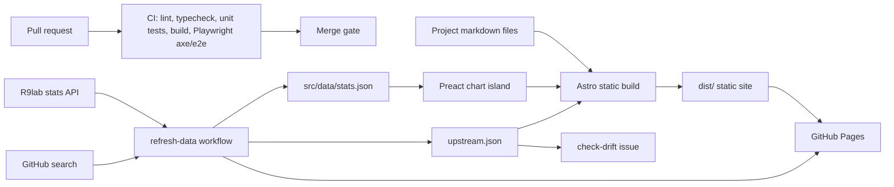

# Architecture

This is a small static portfolio site. I favour reproducible builds, few moving parts at runtime, and enough automation to keep the published figures current.

## Runtime shape

- Astro renders the pages statically, with TypeScript in strict mode.
- Project rows (the parts list) are markdown files under `src/content/projects/`, validated against the schema in `src/content.config.ts`. A number in a card description is written as `{key}` and defined in the card's `figures` field, with its value, a source URL and an `as_of` date. The card renders each one with `data-source` and `data-as-of` attributes. A number written as a word is a number too: the same figure holds it, with the word as `value`. `tests/e2e.spec.ts` fails on a number that has neither a source nor a date, whether it is digits or one of the words two to twelve, dozen, hundred, thousand and million (not "one", which is always idiom), in the hero, Notes A–D, the project cards or the smaller-projects list.
- The only client-side island is `DisassemblyChart.tsx`. It hydrates when it scrolls into view, so users can switch between R9lab measures. It also renders a visually hidden table, so the same data is available without reading the SVG.

## The CV

[/cv/](https://simonvanlierde.com/cv/) renders from `src/data/cv-public.yaml`. The landing page reads only the contact details from it and links to the CV. I export that file and the CV PDF from a separate private repo and commit them here, so a clean checkout builds without access to that repo.

`src/data/cv.ts` validates the export against a Zod schema at build time, so a broken export fails the build instead of rendering an empty page. `src/data/schemaOrg.ts` builds the JSON-LD (structured data for search engines) from the same object. Each page carries a ProfilePage about one Person node; `/` adds the WebSite node that names the site in results. Optional sections (publications, skills, projects, talks and training, interests) render only when the export carries them. An unaccepted publication stays hidden until it has a preprint DOI to link to.

## Data refresh

`src/data/stats.json` is committed because GitHub Pages serves a static build. The weekly `refresh-data.yml` workflow runs `scripts/fetch-stats.mjs`. The script checks that the public R9lab `/stats` response still has the fields the chart reads. The script stamps `fetched_at` on every successful run, so the workflow commits weekly and then deploys; `as_of` still dates the counts.

If the API is unavailable, blocked, or returns an unexpected shape, the script exits successfully without touching the snapshot. That keeps the last known-good build online, instead of quietly rendering zeros. It prints a `::warning::` line, which shows as an annotation on the workflow run.

The same workflow then runs `scripts/fetch-evidence.mjs` (`pnpm fetch:evidence`). It writes `src/data/upstream.json`: my merged pull requests in other people's repos, from one GitHub GraphQL search with the workflow's token, with the branch each went into and the repo's default branch. It keeps the same `as_of` and `fetched_at` dates as `stats.json`, and keeps the file as it is when the search fails. Locally, run it with `GITHUB_TOKEN` set.

Last, it runs `scripts/fetch-cards.mjs` (`pnpm fetch:cards`). For each work or personal card with a demo, it copies the demo page's `og:image` to `src/assets/cards/` and records the file, the page's `og:image:alt` and the fetch date in `src/data/cardImages.json`. The card shows that image under its text; a card whose demo has no `og:image` stays text. A failed fetch keeps that card's last image.

The ranking, grouping and wording of "Merged upstream" stay hand-kept in `src/data/upstream.ts`, which lists each project's PR numbers. The page names the branch when a PR went into one that is not the repo's default (lca_algebraic's `dev`, for example), since that work is not on the default branch yet.

## Checks

Pull requests and pushes to `main` run `pnpm check`, a production Astro build, and Playwright tests. Accessibility is checked twice (what that covers is in [accessibility.md](accessibility.md)):

- **Static**: Biome's `a11y` rules (`pnpm lint`) flag missing `alt` text, misused ARIA, and click handlers without keyboard equivalents.
- **Runtime**: Playwright runs axe-core over the built page (`tests/a11y.spec.ts`) with the WCAG 2.2 A and AA and best-practice rules, in both colour schemes and after interaction. `tests/e2e.spec.ts` checks the skip link, theme-toggle persistence, and the chart's `aria-pressed` toggles.

## Deployment

Pushing to `main` triggers `deploy.yml`, which builds the site and publishes it to GitHub Pages. For this to work, the Pages source must be set to **GitHub Actions** (Settings → Pages). The refresh workflow starts the deploy workflow with `gh workflow run`, and the deploy workflow holds the `pages` concurrency group, so deployments queue instead of racing.

After a deploy succeeds, the `indexnow` job in `deploy.yml` tells search engines which pages changed (IndexNow). `scripts/indexnow.mjs` maps the files changed since the previous deploy to page URLs: `src/pages/index.astro` is `/`, `src/pages/cv.astro` is `/cv/`, and any other change under `src/` or `public/`, or to the package files or Astro config, counts for both. It posts them to `api.indexnow.org` with the key served from `public/<key>.txt`. The key is public by design. A failed ping only prints a warning.

`public/robots.txt` allows every crawler and points at `/sitemap.xml`, which `src/pages/sitemap.xml.ts` writes at build time: both sheets with a `lastmod`, plus the project sites other repos publish under this domain.

Each pull request also gets a preview. Once CI passes, its `preview` job uploads the build as a version of a Cloudflare Worker (`wrangler.jsonc`) whose only deployment is a placeholder page, at `https://pr-<number>-simonvanlierde-site-preview.<account>.workers.dev`. The PR links it as its `preview` deployment. Previews send `X-Robots-Tag: noindex`, so search engines keep to simonvanlierde.com. The job needs a `CLOUDFLARE_API_TOKEN` (Workers Scripts: Edit) and `CLOUDFLARE_ACCOUNT_ID` in the `preview` environment's secrets; without them, and on fork PRs, it skips with a notice. Drafts get no preview. When a PR closes or turns draft, `preview-retire.yml` points its alias at a short "preview closed" page, since wrangler cannot delete an alias; run it by hand with PR numbers to retire older ones. Each version's own hashed URL stays up, as Cloudflare cannot delete a version.

`check-drift.yml` runs 30 minutes after `refresh-data.yml` starts. It keeps one issue open while public repos with new commits are missing from this site, or while the site or the profile README links a repo that was renamed, archived or deleted, while `stats.json` was last fetched more than 21 days ago, or while a pinned repo on the GitHub profile is archived or has no card on this site (card means a `repo:` URL in `src/content/projects`). To skip a repo, list it in `.github/drift-ignore`.

The same issue lists what `scripts/evidence-drift.mjs` finds in `upstream.json`: a merged PR that is neither in `src/data/upstream.ts` nor in its `leftOut` list (a PR as `owner/repo#n`, or a whole repo as `owner/repo`), a listed PR the search no longer finds merged, and a `fetched_at` more than 21 days old.

Renovate opens one PR a month for minor and patch updates and merges it once CI passes, which triggers a deploy. Major updates get their own PRs and wait for me to merge them.

## Non-goals

- No backend for the portfolio site.
- No runtime database. Research datasets and platform data live in their own repositories and services.
- No changelog, and no release per deploy. Every push to `main` deploys, so the commit is the version: the title block's "Site rev" names it and links to it. A tagged release (`package.json` version plus a GitHub release) marks a milestone only: a new sheet, a redesign, or a large content change.
