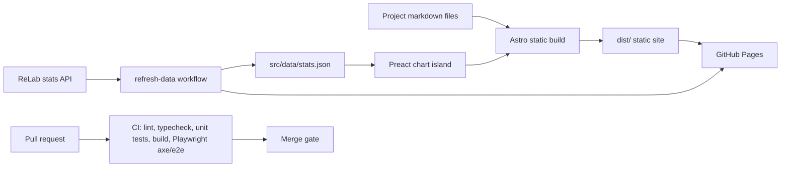

# Architecture

This is a small static portfolio site. I favour reproducible builds, few moving parts at runtime, and enough automation to keep the published figures current.

## Runtime shape

- Astro renders the page statically.
- Project rows (the parts list) come from the typed content collection under `src/content/projects/`.
- Both pages read the CV from `src/data/cv.ts`. It validates the committed `cv-public.yaml` export against a Zod schema. `src/data/schemaOrg.ts` builds the JSON-LD (structured data for search engines) from the same object.
- The only client-side island is `DisassemblyChart.tsx`. It hydrates when it scrolls into view, so users can switch between ReLab measures.
- The chart also renders a visually hidden table, so the same data is available without reading the SVG.

## Data refresh

`src/data/stats.json` is committed because GitHub Pages serves a static build. The scheduled `refresh-data.yml` workflow runs `scripts/fetch-stats.mjs`. The script checks that the public ReLab `/stats` response still has the fields the chart reads. The workflow commits the new snapshot if it changed, then deploys.

If the API is unavailable, blocked, or returns an unexpected shape, the script exits successfully without touching the snapshot. That keeps the last known-good build online, instead of quietly rendering zeros.

## Deployment and checks

Pull requests run `pnpm check`, a production Astro build, and Playwright tests with axe accessibility scans. Merges to `main` deploy through GitHub Pages. The refresh and deploy workflows share one Pages concurrency group, so deployments queue instead of racing.

## Non-goals

- No backend for the portfolio site.
- No runtime database. Research datasets and platform data live in their own repositories and services.
- No release changelog for the site itself. Git history and pull requests record the changes.
